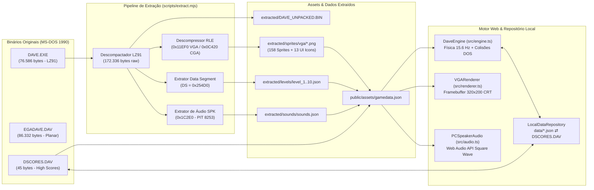

# Dangerous Dave (1990) — Remaster 60 FPS & Engenharia Reversa

> **Engenharia Reversa, Remasterização 60 FPS, Extrator Binário & Codificação Web:** [**realzurr**](https://github.com/realzurr) (`github.com/realzurr`)  
> **Jogo Original de MS-DOS (1990):** **John Romero** / *Softdisk, Inc.*
>
> Reconstrução e **Remasterização Moderna em 60 FPS** para Web (**HTML5 Canvas + TypeScript + Web Audio Synthwave**) a partir da engenharia reversa direta dos binários originais de MS-DOS de **Dangerous Dave (1990)**.

---

## ✨ Novidades da Edição Remaster (`branch: remaster`)

Esta branch (`remaster`) moderniza os gráficos, o áudio e a jogabilidade de *Dangerous Dave*, mantendo a opção de alternar em tempo real na barra superior entre o **Modo Moderno HD** e o **Modo Clássico 1990**:

1. **⚡ Mais Agilidade e Física Contínua a 60 FPS (`src/engine.ts`)**:
   - **Câmera Suave Contínua (`cameraX` Lerp)**: Fim do congelamento de tela a cada 15 colunas — a câmera acompanha o Dave suavemente em sub-pixel por todo o mapa de `1600px`.
   - **Cyber Dash (`Shift` ou `C`)**: Nova mecânica de *Dash* horizontal em alta velocidade com invulnerabilidade a projéteis, rastro neon ciano (*afterimages*) e barra de recarga no HUD.
   - **Coyote Time, Jump Buffering & Pulo de Altura Variável**: Controles ultra-responsivos com aceleração fluida e efeito elástico *Squash & Stretch* ao pular e aterrissar.
   - **Sistema de Combo (`x2` a `x8`)**: Coletar tesouros em sequência multiplica os pontos e eleva a harmonia sonora dos cristais.
2. **🎨 Gráficos Modernos HD (`src/renderer.ts`)**:
   - **Cenários em Parallax Multi-Camadas**: Fundos dinâmicos com cavernas subterrâneas, estrelas cintilantes e grades geométricas que mudam de paleta conforme a fase.
   - **Iluminação Dinâmica & Bevel 3D**: Brilho neon em troféus, armas, jetpacks e portais, refração de ondas na água, aura de calor no fogo e relevo especular 3D nos blocos.
   - **Sistema de Partículas, Textos Flutuantes & Screen Shake**: Faíscas, fumaça de propulsão no Jetpack, poeira ao pular/pousar, explosões com tremor de câmera e popups de pontuação (`+500 x3!`).
3. **🎹 Áudio Sintetizado Polifônico & Trilha Synthwave (`src/audio.ts`)**:
   - **Sequenciador Synthwave Procedural**: Trilha sonora eletrônica gerada em tempo real via Web Audio API (baixo *sawtooth* filtrado, *kick* e arpejos melódicos).
   - **Efeitos Sonoros Polifônicos Modernos**: Disparos de *Laser Blaster*, *whoosh* de *Dash*, acordes de cristal nos tesouros, explosões com *sub-bass* e fanfarra de troféu (com botão para alternar para o **PC Speaker 1990** a qualquer momento).

---

## Sumário

1. [Visão Geral](#-visão-geral)
2. [Fluxo de Engenharia Reversa](#-fluxo-de-engenharia-reversa)
3. [Análise Técnica dos Binários Originais](#-análise-técnica-dos-binários-originais)
   - [1. Descompactação LZEXE 0.91 (`DAVE.EXE`)](#1-descompactação-lzexe-091-daveexe)
   - [2. Mapa Completo de Memória (`172.336 bytes`)](#2-mapa-completo-de-memória-172336-bytes)
   - [3. Descompressão RLE e Formato de Sprites VGA](#3-descompressão-rle-e-formato-de-sprites-vga)
   - [4. Estrutura das 10 Fases e Rotas de Monstros](#4-estrutura-das-10-fases-e-rotas-de-monstros)
   - [5. Como Funcionam as 4 Warp Zones Secretas](#5-como-funcionam-as-4-warp-zones-secretas)
   - [6. Tabelas de Física, Colisão e Pontuação (`Data Segment`)](#6-tabelas-de-física-colisão-e-pontuação-data-segment)
   - [7. Sintetizador PC Speaker (`0x1C2E0 "SPK\0"`)](#7-sintetizador-pc-speaker-0x1c2e0-spk0)
   - [8. Formato Binário de Recordes (`DSCORES.DAV`)](#8-formato-binário-de-recordes-dscoresdav)
4. [Estrutura do Repositório](#-estrutura-do-repositório)
5. [Repositório Local de Dados e API de Persistência](#-repositório-local-de-dados-e-api-de-persistência)
6. [Controles e Inspector de Engenharia Reversa](#-controles-e-inspector-de-engenharia-reversa)
7. [Como Executar o Projeto](#-como-executar-o-projeto)
8. [Autoria, Créditos & Licença](#-autoria-créditos--licença)

---

## 🎮 Visão Geral

Este projeto realiza a **engenharia reversa completa** dos três arquivos originais de MS-DOS presentes no diretório raiz (`DAVE.EXE`, `EGADAVE.DAV` e `DSCORES.DAV`) sem depender de ferramentas externas fechadas, extraindo diretamente do código de máquina 16-bit x86 e do segmento de dados (`DS`):

- Todos os **158 tiles e sprites VGA** (256 cores) com aplicação exata das máscaras lógicas `AND` de hardware.
- Os **128 glifos da fonte VGA `8x8`** (incluindo caracteres de moldura das janelas Softdisk) e os **13 ícones do Painel de Controle (`32x24`)**.
- As **10 fases originais (`100x10` tiles)**, mais o mini-mapa `10x7` da tela título e as **4 *Warp Zones* secretas**.
- As **tabelas físicas originais** (curva de velocidade vertical do pulo, pontos de sondagem de colisão, tiles escaláveis, letais e coletáveis).
- Os **12 efeitos sonoros do PC Speaker**, sintetizados em tempo real no navegador via **Web Audio API** usando os divisores originais do chip **Intel 8253 PIT**.
- Um **Repositório Local de Dados** (`data/`) com sincronização bidirecional entre o navegador, arquivos JSON em disco e o arquivo binário original `DSCORES.DAV` de 45 bytes.

---

## 🔄 Fluxo de Engenharia Reversa



---

## 🔬 Análise Técnica dos Binários Originais

### 1. Descompactação LZEXE 0.91 (`DAVE.EXE`)

O arquivo `DAVE.EXE` (`76.586 bytes`) possui no offset `0x1C` a assinatura ASCII `LZ91` (*Fabrice Bellard LZEXE v0.91*).
- No cabeçalho MZ:
  - `e_cparhdr` (`0x08`) = `0x0002` (cabeçalho de 32 bytes, imagem comprimida inicia em `0x0020`).
  - `e_ip` (`0x14`) = `0x000E`, `e_cs` (`0x16`) = `0x1298` (tabela de parâmetros e stub de descompressão em `(0x1298 + 2) * 16 = 0x129A0`).
- O fluxo comprimido utiliza palavras de 16 bits (`uint16_le`) lidas como um *bitstream* LSB-first:
  - Bit `1`: Copia 1 byte literal diretamente para a saída.
  - Bit `0` seguido de `0`: Lê 2 bits (`len = bits + 2`, ou seja, `2..5` bytes) e 1 byte de deslocamento negativo (`span = byte | 0xFF00`, de `-256` a `-1`).
  - Bit `0` seguido de `1`: Lê 2 bytes (`low`, `high`). O deslocamento de 13 bits é `span = (((high >> 3) | 0xFFE0) << 8) | low` (`-8192` a `-1`), e `len = (high & 0x07) + 2`. Caso `(high & 0x07) == 0`, lê um byte adicional de comprimento (`0` = fim do fluxo, `1` = normalização de registrador de segmento `ES:DI`, `>1` = `byte + 1`).
- Resultado: uma imagem contínua de código + dados de exatos **`172.336 bytes` (`0x2A130`)**, salva em `extracted/DAVE_UNPACKED.BIN`.

---

### 2. Mapa Completo de Memória (`172.336 bytes`)

> **Nota sobre offsets de ferramentas externas:** Descompactadores como o `UNLZEXE.EXE` antepõem um cabeçalho MZ reconstruído de `0x200` (`512`) bytes. Portanto, qualquer offset linear na imagem pura (`raw`) corresponde a `offset_unlzexe - 0x200`.

| Offset Linear (`raw`) | Com Header `+0x200` | Segmento:Offset | Tamanho | Conteúdo |
| :--- | :--- | :--- | :--- | :--- |
| `0x00000 .. 0x0B30F` | `0x00200 .. 0x0B50F` | `0000:0000` | `45.840 B` | Código de máquina 16-bit x86 (Turbo C++ 1990) |
| `0x0B310 .. 0x0C41F` | `0x0B510 .. 0x0C61F` | `0B31:0000` | `4.368 B` | Dados auxiliares apontados por `DS:0x57A4` |
| `0x0C420 .. 0x11EEF` | `0x0C620 .. 0x120EF` | `0C42:0000` | `23.248 B` | **Tiles & Sprites CGA** (RLE → `27.818 B` descomprimido) |
| `0x11EF0 .. 0x1C2DF` | `0x120F0 .. 0x1C4DF` | `11EF:0000` | `41.968 B` | **Tiles & Sprites VGA** (RLE → `71.238 B` descomprimido) |
| `0x1C2E0 .. 0x1D57F` | `0x1C4E0 .. 0x1D77F` | `1C2E:0000` | `4.768 B` | **Bloco de Sons `SPK\0`** (12 efeitos de PC Speaker) |
| `0x1D580 .. 0x1E83F` | `0x1D780 .. 0x1EA3F` | `1D58:0000` | `4.800 B` | Fonte `8x8` e ícones de UI para modo CGA |
| `0x1E840 .. 0x20CBF` | `0x1EA40 .. 0x20EBF` | `1E84:0000` | `9.344 B` | Fonte `8x8` e ícones de UI para modo EGA |
| `0x20CC0 .. 0x254CF` | `0x20EC0 .. 0x256CF` | `20CC:0000` | `18.448 B` | **Fonte `8x8` VGA** (128 glifos) + **13 Ícones de UI** (`32x24`) |
| `0x254D0 .. 0x26909` | `0x256D0 .. 0x26B09` | `254D:0000` | `5.178 B` | **Data Segment (`DS`)**: Tabelas de física, colisão, monstros e textos |
| `0x2690A .. 0x26C09` | `0x26B0A .. 0x26E09` | `254D:143A` | `768 B` | **Paleta VGA de 256 cores** (`256 x 3 bytes`, RGB 6-bit `0..63`) |
| `0x26C0A .. 0x29E09` | `0x26E0A .. 0x2A009` | `254D:173A` | `12.800 B` | **10 Fases do Jogo** (`10 x 1.280 bytes`) |
| `0x29E0A .. 0x2A12F` | `0x2A00A .. 0x2A32F` | `254D:493A` | `806 B` | Tabelas da biblioteca runtime Borland Turbo C++ |

---

### 3. Descompressão RLE e Formato de Sprites VGA

O bloco VGA em `0x11EF0` inicia com um `uint32_le` indicando o tamanho descomprimido (`71.238 bytes`). A rotina de descompressão em `0x7BFC` lê bytes de controle `b`:
- Se `b & 0x80` (bit 7 ativo): copia os próximos `1 + (b & 0x7F)` bytes literais.
- Se `(b & 0x80) == 0`: repete o próximo byte `3 + b` vezes.

Dentro dos `71.238 bytes` descomprimidos:
- `0x0000`: `uint32_le count = 158` (`0x9E` entradas).
- `0x0004 .. 0x027B`: Tabela de `158` offsets (`uint32_le`).
- **Índices `0..52` (Tiles do Cenário)**: `256 bytes` fixos cada (`16x16` pixels sem cabeçalho de dimensões).
- **Índices `53..147` (Sprites de Personagem, Monstros, Projéteis e Banners)**: Iniciam com `width` (`uint16_le`) e `height` (`uint16_le`), seguidos de `width * height` bytes de pixels indexados na paleta VGA:
  - `53..59`: Dave caminhando p/ direita (`53..55`), parado (`56`), caminhando p/ esquerda (`57..59`) — `20x16`.
  - `60..66`: Máscaras binárias `AND` correspondentes aos sprites `53..59` (`0x00` = opaco, `0xFF` = transparente).
  - `67..68` e `69..70`: Dave pulando (direita/esquerda) e respectivas máscaras `AND` — `20x16`.
  - `71..73` e `74..76`: Dave escalando e respectivas máscaras `AND` — `20x16`.
  - `77..82` e `83..88`: Dave com Jetpack (direita/esquerda) e respectivas máscaras `AND` — `20x16`.
  - `89..120`: 8 tipos de monstros (4 frames cada, um tipo para cada fase de 3 a 10):
    - `89..92`: Aranha (Fase 3, `28x20`)
    - `93..96`: Redemoinho Roxo (Fase 4, `24x20`)
    - `97..100`: Sol Vermelho (Fase 5, `24x21`)
    - `101..104`: Barra Verde (Fase 6, `24x22`)
    - `105..108`: Disco Cinza (Fase 7, `18x8`)
    - `109..112`: Cogumelo Rosa (Fase 8, `16x12`)
    - `113..116`: Caveira Verde (Fase 9, `16x16`)
    - `117..120`: Lâminas Giratórias (Fase 10, `16x20`)
  - `121..126`: Bolas de fogo dos monstros (`20x3`).
  - `127..128`: Bala do Dave (`12x3`).
  - `129..132`: Explosão (`20x13`).
  - `133..143`: Elementos da HUD (`SCORE`, `LEVEL`, `DAVES`, `"GO THRU THE DOOR!"`, `JETPACK`, `GUN`, `"WARP ZONE"`, barra de combustível e ícone de vida).
  - `144..147`: Logo animado `"DANGEROUS DAVE"` da tela título (`112x47`, 4 frames).
- **Índices `148..157` (Dígitos `'0'..'9'` da HUD)**: `92 bytes` cada (`4 bytes` de cabeçalho + `8x11` pixels).

---

### 4. Estrutura das 10 Fases e Rotas de Monstros

A partir do offset `0x26C0A` (`DS:0x173A`), existem 10 blocos consecutivos de **`1.280 bytes`** (`0x500`):

| Offset no Bloco | Tamanho | Descrição |
| :--- | :--- | :--- |
| `0x000 .. 0x0FF` | `256 bytes` | **Vetor de Patrulha dos Monstros**: pares de bytes com sinal `(dx, dy)` (`int8`) executados ciclicamente a cada tick. A sequência termina no marcador `0xEA, 0xEA` (quando o índice da rota volta a `0`). |
| `0x100 .. 0x4E7` | `1.000 bytes` | **Matriz de Tiles `100x10`** (armazenada em ordem *row-major*: `row * 100 + col`, onde `row = 0..9` e `col = 0..99`). |
| `0x4E8 .. 0x4FF` | `24 bytes` | Padding não utilizado. |

Os **Monstros** de cada fase são inicializados copiando registros de `80 bytes` (`0x50`) localizados em `0x25966` (`DS:0x0496 + level * 80`), contendo até 4 monstros por fase com os campos:
- `active[4]` (`uint16_le` em `+0x00`)
- `world_x[4]` (`uint16_le` em `+0x08`, em pixels de `0..1599`)
- `screen_y[4]` (`uint16_le` em `+0x10`, em pixels de `16..175`)
- `path_index[4]` (`uint16_le` em `+0x18`, passo inicial no vetor de patrulha)
- `fire_reload[4]` (`uint16_le` em `+0x20`, cadência de tiro)

---

### 5. Como Funcionam as 4 Warp Zones Secretas

Um detalhe fascinante descoberto na engenharia reversa do código em `0x32DE .. 0x3510`: **não existem arquivos de mapa extras para as 4 Warp Zones**. Em vez disso, como as fases normais 1, 2, 6 e 7 são mais curtas que 100 colunas, John Romero construiu as 4 Warp Zones **nas colunas direitas restantes dessas mesmas fases**!

Quando o Dave salta acima do topo da tela (`Dave_y < 16`) na extremidade esquerda (`scrollX == 0`) ou direita (`scrollX == 80`), a rotina consulta quatro tabelas de 10 palavras em `DS`:

| Fase de Origem | Tabela `DS:0x016A` (Mapa Alvo) | Tabela `DS:0x0192` (`scrollX`) | Tabela `DS:0x01A6` (`Dave_x`) | Tabela `DS:0x017E` (Tile da Chaminé) |
| :---: | :---: | :---: | :---: | :---: |
| **Fase 5** | Mapa da **Fase 2** (`col 42..99`) | `42` | `144` | Tile `5` (Tijolo Azul) |
| **Fase 8** | Mapa da **Fase 6** (`col 67..99`) | `67` | `64` | Tile `17` (Tijolo Vermelho) |
| **Fase 9** | Mapa da **Fase 7** (`col 71..99`) | `71` | `144` | Tile `18` (Rocha Verde) |
| **Fase 10** | Mapa da **Fase 1** (`col 11..99`) | `11` | `144` | Tile `29` (Tubo Roxo) |

Ao entrar na porta (`Tile 2`) dentro de uma Warp Zone, o jogo restaura o índice da fase original (`saved_level` em `DS:0x6152`) e avança para a próxima fase normal.

---

### 6. Tabelas de Física, Colisão e Pontuação (`Data Segment`)

Extraídas diretamente de `DS` (`0x254D0`):

- **Curva de Pulo (`DS:0x00BC` / `0x2558C`)**:
  Array de 41 inteiros com sinal (`int16_le`) terminado por `128` (`0x0080`), fornecendo o deslocamento vertical `dy` exato a cada tick do salto:
  `[-3, -2(x11), -1(x5), 0(x7), +1(x7), +2(x9), +3]`.
- **Itens Coletáveis (`DS:0x023A` e `DS:0x024E`)**:
  - `Tile 2` (Porta): `2.000 pts` (requer Troféu para concluir a fase)
  - `Tile 4` (Jetpack): `0 pts` (abastece o tanque de combustível em `255` unidades)
  - `Tile 20` (Arma): `0 pts` (habilita disparos infinitos na fase atual)
  - `Tile 10` (Troféu): `1.000 pts` (habilita a saída pela porta e exibe o banner `"GO THRU THE DOOR!"`)
  - `Tile 47` (Diamante Azul): `100 pts`
  - `Tile 48` (Esfera Roxa): `50 pts`
  - `Tile 49` (Diamante Vermelho): `150 pts`
  - `Tile 50` (Coroa): `300 pts`
  - `Tile 51` (Anel): `200 pts`
  - `Tile 52` (Varinha): `500 pts`
- **Propriedades dos Tiles `0..52` (`DS:0x0262` e `DS:0x02CC`)**:
  - **Escaláveis (`DS:0x0262 == 1`)**: Tiles `33..35` (troncos/galhos de árvores) e `41..46` (estrelas, lua e copa das árvores).
  - **Sólidos (`DS:0x02CC == 1`)**: Tiles `1, 3, 5, 15, 16, 17, 18, 19, 21, 22, 23, 24, 29, 30`.
  - **Letais (`DS:0x02CC == 2`)**: Tiles `6..9` (fogo), `25..28` (água) e `36..40` (*weirdweeds* / tentáculos).

---

### 7. Sintetizador PC Speaker (`0x1C2E0 "SPK\0"`)

O bloco em `0x1C2E0` inicia com o cabeçalho `"SPK\0"` seguido de 12 descritores de 16 bytes (`offset`, `priority`, `timerRate`, `name[12]`):

| ID | Nome Original | Offset | Prioridade | `timerRate` | Taxa de Amostragem (`18.2065 Hz * rate`) | Amostras |
| :---: | :--- | :---: | :---: | :---: | :---: | :---: |
| `1` | `HitWall` | `0x0400` | `0` | `10` | `182,07 Hz` | `16` |
| `2` | `Falling` | `0x0422` | `11` | `10` | `182,07 Hz` | `318` |
| `3` | `OUCH!` | `0x06A0` | `0` | `12` | `218,48 Hz` | `78` |
| `4` | `Walking` | `0x073E` | `0` | `5` | `91,03 Hz` | `1` |
| `5` | `Jumping` | `0x0742` | `0` | `7` | `127,45 Hz` | `319` |
| `6` | `Treasure` | `0x09C2` | `10` | `15` | `273,10 Hz` | `31` |
| `7` | `GotTrophy` | `0x0A02` | `15` | `15` | `273,10 Hz` | `250` |
| `8` | `explosion` | `0x0BF8` | `20` | `16` | `291,30 Hz` | `262` |
| `9` | `Flying!` | `0x0E06` | `0` | `10` | `182,07 Hz` | `1` |
| `10` | `NextLevel` | `0x0E0A` | `10` | `15` | `273,10 Hz` | `320` |
| `11` | `ToJetpack` | `0x108C` | `20` | `10` | `182,07 Hz` | `44` |
| `12` | `GotSomethng` | `0x10E6` | `10` | `25` | `455,16 Hz` | `112` |

Cada amostra `w` (`uint16_le`, terminada por `0xFFFF`) é enviada à porta `0x42` do temporizador **PIT 8253**, produzindo uma onda quadrada de frequência:
$$f_{\text{Hz}} = \frac{1.193.181}{w}$$

---

### 8. Formato Binário de Recordes (`DSCORES.DAV`)

O arquivo `DSCORES.DAV` possui exatos **`45 bytes`**, divididos em **5 registros de 9 bytes**:
- `byte[0]`: Nível alcançado (`uint8`).
- `byte[1..5]`: Os 5 dígitos decimais individuais da pontuação (`0..9`), onde `score = b[1]*10000 + b[2]*1000 + b[3]*100 + b[4]*10 + b[5]`.
- `byte[6..8]`: As 3 letras das iniciais do jogador em ASCII (ex.: `"REN"`, `"JON"`).

---

## 📁 Estrutura do Repositório

```text
D:\games\DOS\DDAVE\
├── DAVE.EXE                    # Executável DOS original de 1990 (compactado com LZ91)
├── EGADAVE.DAV                 # Gráficos EGA originais (planar 16 cores)
├── DSCORES.DAV                 # Tabela de recordes binária original (sincronizada c/ Web)
├── scripts/
│   └── extract.mjs             # Descompactador LZ91 + Extrator RLE/ Mapas/ Sons/ PNGs
├── data/                       # Repositório Local de Dados em Disco
│   ├── highscores.json         # Recordes sincronizados com DSCORES.DAV
│   └── saves.json              # Save States completos das partidas (F5 / F7)
├── extracted/                  # Artefatos brutos gerados pela engenharia reversa
│   ├── DAVE_UNPACKED.BIN       # Imagem de código+dados descompactada (172.336 bytes)
│   ├── levels/                 # JSONs individuais das fases 1 a 10
│   ├── sounds/                 # JSON com divisores PIT dos 12 efeitos sonoros
│   └── sprites/                # 158 PNGs VGA + 13 PNGs de ícones de UI
├── public/
│   └── assets/
│       └── gamedata.json       # Bundle unificado consumido pelo cliente Web
├── src/
│   ├── types.ts                # Contratos TypeScript dos dados extraídos
│   ├── audio.ts                # Sintetizador PC Speaker via Web Audio API
│   ├── renderer.ts             # Renderizador VGA 320x200 (Canvas 2D + Fonte 8x8)
│   ├── repository.ts           # Cliente de persistência local (API REST + localStorage)
│   ├── engine.ts               # Motor de jogo, física, IA, Warp Zones e HUD
│   ├── main.ts                 # Bootstrap, controles e Inspector de Engenharia Reversa
│   └── style.css               # Estilização do monitor CRT e painel de debug
├── index.html                  # Página principal da aplicação Web
├── vite.config.ts              # Servidor Vite + Middleware REST (/api/repository/*)
├── tsconfig.json               # Configuração TypeScript
└── package.json                # Scripts e dependências do projeto
```

---

## 💾 Repositório Local de Dados e API de Persistência

O plugin `localDataRepositoryPlugin` em `vite.config.ts` expõe uma API local em `/api/repository` que armazena os dados em `data/` e mantém o binário `DSCORES.DAV` sincronizado:

| Método | Endpoint | Descrição |
| :---: | :--- | :--- |
| `GET` | `/api/repository/status` | Retorna o estado completo do repositório (`highscores.json`, `saves.json` e caminhos em disco). |
| `GET` | `/api/repository/highscores` | Retorna a lista dos 5 maiores recordes salvos em `data/highscores.json`. |
| `POST` | `/api/repository/highscores` | Atualiza `data/highscores.json` e **reescreve os 45 bytes binários de `DSCORES.DAV`** no formato original de MS-DOS. |
| `GET` | `/api/repository/saves` | Lista os *Save States* armazenados em `data/saves.json`. |
| `POST` | `/api/repository/saves` | Salva um novo *Save State* (fase, pontuação, vidas, itens, coordenadas `(x, y)` e `scrollX`) em `data/saves.json`. |

---

## 🕹️ Controles e Inspector de Engenharia Reversa

### Teclas de Jogo

| Tecla | Ação |
| :--- | :--- |
| **Setas Esquerda / Direita** ou **A / D** | Caminhar / Voar para os lados |
| **Seta p/ Cima** ou **W** ou **Espaço** | Pular / Subir em árvores e estrelas |
| **Seta p/ Baixo** ou **S** | Descer em árvores/estrelas ou com Jetpack |
| **Ctrl** ou **Z** | Disparar arma (quando coletada) |
| **Alt** ou **X** ou **Shift** | Ligar / Desligar o Jetpack |
| **F1** | Exibir as 3 telas de Ajuda originais |
| **F3** | Reiniciar partida |
| **F5** | **Quick Save** no repositório local (`data/saves.json`) |
| **F7** | **Quick Load** do último estado salvo |
| **F9** | Pausar / Retomar partida |
| **M** | Ativar / Desativar som do PC Speaker |

### Painel `🛠️ Engenharia Reversa`

Clicando no botão **`🛠️ Engenharia Reversa`** no topo da interface Web, você tem acesso a:
- **Seletor de Fases (`Fase 1` .. `Fase 10`)**: Pula instantaneamente para qualquer nível.
- **Seletor de Warp Zones (`🌀 Warp Fase 5, 8, 9, 10`)**: Dispara a cutscene de queda pela chaminé e carrega a respectiva zona secreta.
- **Cheats e Telemetria em Tempo Real**: Botões para conceder Jetpack cheio, Arma, Troféu e **God Mode** (invencibilidade e combustível infinito), além de monitor de coordenadas de tela, grade `(col, row)` e `scrollX`.
- **Testador do Sintetizador PC Speaker**: Botões para tocar individualmente cada um dos 12 efeitos sonoros extraídos do bloco `SPK\0`.
- **Galeria de Sprites**: Visualização dos 158 tiles, sprites e máscaras `AND` extraídos do bloco VGA.

---

## 🚀 Como Executar o Projeto

### Pré-requisitos
- **Node.js** `v18+` (testado em `v24.16.0`)

### Passo a Passo

```bash
# 1. Instalar dependências
npm install

# 2. (Opcional) Re-executar o descompactador LZ91 e extrator de assets do DAVE.EXE
npm run extract

# 3. Iniciar o servidor Web com o repositório local ativo
npm run dev
```

Em seguida, abra **`http://localhost:5173/`** no navegador.

Para gerar o bundle estático de produção em `dist/`:

```bash
npm run build
```

---

## 👨‍💻 Autoria, Créditos & Licença

### Autoria e Créditos
- **Processo de Engenharia Reversa, Descompactador LZ91/RLE, Extração de Assets e Motor Web (TypeScript / HTML5 Canvas / Web Audio API):**  
  Desenvolvido por **[realzurr](https://github.com/realzurr)** — [`github.com/realzurr`](https://github.com/realzurr)
- **Jogo Original (*Dangerous Dave*, MS-DOS, 1990):**  
  Criado e programado originalmente por **John Romero** e publicado pela **Softdisk, Inc.**

### 📜 Licença ([`LICENSE`](./LICENSE))

Este repositório é regido pela **Licença MIT com Atribuição Obrigatória e Aviso de Obra Original** (consulte o arquivo [`LICENSE`](./LICENSE) para o texto integral em Português e Inglês):

1. **Código de Engenharia Reversa e Implementação Web (`Copyright (c) 2026 realzurr`)**:  
   O código-fonte do motor Web (`src/`), o extrator binário (`scripts/extract.mjs`), a arquitetura do repositório local e a documentação técnica de engenharia reversa são licenciados sob os termos da licença MIT, sendo **obrigatória a manutenção do crédito visível a [realzurr](https://github.com/realzurr) (`https://github.com/realzurr`)** em qualquer cópia, redistribuição ou trabalho derivado.
2. **Obra Original (`Copyright (c) 1990 John Romero / Softdisk, Inc.`)**:  
   Os binários originais de MS-DOS (`DAVE.EXE`, `EGADAVE.DAV`, `DSCORES.DAV`), bem como os gráficos, mapas e efeitos sonoros originais de *Dangerous Dave*, permanecem sob titularidade intelectual de **John Romero / Softdisk, Inc.**, exigindo atribuição expressa aos autores originais em qualquer apresentação ou distribuição, sendo utilizados neste projeto para fins de preservação histórica, estudo de engenharia reversa e interoperabilidade educacional.


